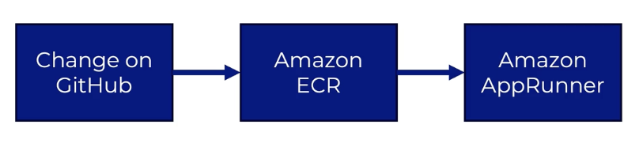

# Elastic Container Registry(ECR)

## What?

- Amazon Elastic Container Registry (ECR) is AWS's managed registry for storing and sharing container images.
- Think of it as a private warehouse for Docker images: applications can collect the exact image version they need when they are deployed.
- AWS handles the underlying infrastructure for hosting our registry.
- An ECR repository stores related images, and each image can have tags such as `latest` or `v1.0.0`.

## How?

- Create an ECR repository for the application.
- Authenticate Docker with ECR using the AWS CLI or another supported tool.
- Build a Docker image and tag it with the ECR repository address.
- Push the image to ECR, where AWS stores and scans it according to the repository settings.
- Allow services such as App Runner, ECS, EKS, or EC2 to pull the image using IAM permissions.
- Use specific version tags for reliable deployments instead of relying only on the moving `latest` tag.

## Why?

- Tightly integrated withing the AWS ecosystem: ECR keeps container images close to AWS services, making deployments simpler and often faster.
    - Integrated into AppRunner, ECS, EKS, etc.
- Automatically scales
- IAM integration controls which users and services can push or pull images.
- Versioned images make releases repeatable and make it easier to roll back to a known working version.
- ECR removes the need to operate and maintain your own Docker registry.


## Registry vs repository vs images

- **Registry:** The complete service or warehouse that stores and manages container images. In this case, Amazon ECR is the registry.
- **Repository:** A named storage area inside the registry for images belonging to one application or project. For example, `my-app` can be an ECR repository.
- **Image:** The packaged application, including the code, dependencies, and configuration needed to run a container. For example, `my-app:v1.0.0` is an image with the tag `v1.0.0`.

> **Analogy:** ECR is the warehouse, a repository is one shelf for a project, and each image is a packaged box stored on that shelf.
>
> **Hierarchy:** Registry -> repository -> image:tag

## Steps to create a repository in ECR

1. Open the AWS Console, search for **Elastic Container Registry**, and select **Repositories**.
2. Select **Create repository**.
3. Under **Repository creation**, choose **Private** unless the images must be publicly available.
4. Enter a unique **Repository name**, such as `my-app` or `team-a/my-app`.
5. For **Tag immutability**, choose **Immutable** to prevent an existing tag from being overwritten, or **Mutable** when tags such as `latest` need to move to newer images.
6. For **Image scanning**, enable **Scan on push** if you want ECR to scan each newly pushed image for known vulnerabilities.
7. For **Encryption**, keep **AES-256** for the standard AWS-managed encryption option, or choose **KMS** when you need to manage the encryption key yourself.
8. Review the settings and select **Create repository**.
9. Open the new repository and copy its URI, which is used when tagging and pushing Docker images.

> **Example repository URI:** `123456789012.dkr.ecr.us-east-1.amazonaws.com/my-app`

## Steps to push to repository

1. Make sure the AWS CLI and Docker are installed, and configure the AWS CLI with credentials that can access ECR.
2. Set variables for your AWS account, Region, repository, and image tag:

    ```bash
    AWS_ACCOUNT_ID=123456789012
    AWS_REGION=us-east-1
    REPOSITORY_NAME=my-app
    IMAGE_TAG=v1.0.0
    ECR_URI=$AWS_ACCOUNT_ID.dkr.ecr.$AWS_REGION.amazonaws.com/$REPOSITORY_NAME
    ```

3. Authenticate Docker with the ECR registry:

    ```bash
    aws ecr get-login-password --region $AWS_REGION \
      | docker login --username AWS --password-stdin $ECR_URI
    ```

4. Build the Docker image from the application's directory:

    ```bash
    docker build --platform linux/amd64 -t $REPOSITORY_NAME:$IMAGE_TAG .
    ```

5. Tag the local image with the ECR repository URI:

    ```bash
    docker tag $REPOSITORY_NAME:$IMAGE_TAG $ECR_URI:$IMAGE_TAG
    ```

6. Push the tagged image to ECR:

    ```bash
    docker push $ECR_URI:$IMAGE_TAG
    ```

7. Verify the image in the AWS Console or with the AWS CLI:

    ```bash
    aws ecr describe-images \
      --repository-name $REPOSITORY_NAME \
      --region $AWS_REGION
    ```

> **Tip:** Use an immutable version tag such as `v1.0.0` or a Git commit ID so deployments can identify the exact image. Use `latest` only when a moving tag is intentional.

## Deploying to AppRunner

1. Open the AWS Console, search for **App Runner**, and select **Create service**.
2. Under **Source**, choose **Container registry**.
3. Choose **Amazon ECR** as the provider and select the image repository and image tag you pushed earlier.
4. Choose a **Deployment settings** option:
    - **Automatic:** App Runner deploys a new service version when a new image is pushed to the selected tag.
    - **Manual:** You choose when App Runner deploys a new image.
5. Configure **ECR access**:
    - Choose an existing ECR access role, or allow App Runner to create one with the required permissions.
    - This role lets App Runner pull the private image from ECR.
6. Enter a **Service name**, such as `my-app-service`.
7. Configure the container settings:
    - **Port:** Enter the port on which the application listens, such as `8080`.
    - **Start command:** Enter one only if the Docker image does not already define its startup command.
    - **Environment variables:** Add application configuration values required at runtime.
8. Choose the service **CPU and memory** settings, and configure the minimum and maximum instance count if needed.
9. Configure optional settings such as automatic scaling, health checks, and a VPC connector for accessing private VPC resources.
10. Review the estimated cost and service settings, then select **Create and deploy**.
11. Wait for the service status to become **Running**, then open the App Runner default domain to test the application.

> **Important:** The container must listen on the same port configured in App Runner and should listen on `0.0.0.0`, not only on `localhost`.

## Link Custom Domain to App Runner

1. Make sure you own a domain and can edit its DNS records through Route 53 or your domain registrar.
2. Open the AWS Console, search for **App Runner**, and open the service you want to configure.
3. Open the **Custom domains** tab and select **Link domain** or **Add custom domain**.
4. Enter the domain name, such as `example.com`, and confirm that you want App Runner to manage the TLS certificate.
5. Select **Link**. App Runner displays DNS records for certificate validation and domain routing.
6. Open your DNS provider and add the certificate validation records exactly as App Runner shows them.
7. Add the routing record provided by App Runner:
    - For a subdomain such as `app.example.com`, create a `CNAME` record pointing to the App Runner target.
    - For an apex domain such as `example.com`, use the DNS provider's supported `ALIAS`, `ANAME`, or equivalent record because standard DNS does not allow a `CNAME` at the zone apex.
8. Wait for DNS propagation and for App Runner to show the domain as **Running** or **Active**.
9. Open the custom domain in a browser and verify that the application loads over HTTPS.

> **DNS record types:**
>
> - **CNAME:** Creates an alias from one hostname to another hostname. Use it for subdomains and for the CNAME records App Runner provides for certificate validation.
> - **ALIAS:** A provider-specific record that points an apex domain to an AWS or other service target. It behaves like a CNAME but works at the zone apex.
> - **ANAME:** A record type supported by some DNS providers that serves a similar purpose to ALIAS for an apex domain.
> - **A record:** Maps a hostname directly to an IPv4 address. App Runner normally provides a hostname target, so use its recommended CNAME, ALIAS, or ANAME record instead of manually creating an A record.

> **Note:** Keep the App Runner DNS validation records in place. App Runner uses them to validate and renew the managed TLS certificate.

## Connect to `www` Subdomain

### Why is this needed?

- `example.com` and `www.example.com` are different hostnames, so configuring the root domain does not automatically configure the `www` subdomain.
- The `www` hostname needs its own DNS routing record and must be included in App Runner's TLS certificate validation.
- Supporting both addresses lets users reach the application whether they type the root domain or the `www` version.

### Route 53 DNS steps

1. First link `www.example.com` in App Runner so App Runner can provide the certificate-validation and routing values.
2. Open the AWS Console, search for **Route 53**, and select **Hosted zones**.
3. Create a hosted zone for the domain, such as `www.example.com`, and choose **Public hosted zone**.
4. If the domain was registered outside Route 53, copy the four Route 53 name servers and replace the domain registrar's existing name servers with them. This delegates DNS management to Route 53.
5. In the hosted zone, select **Create record** and add each certificate-validation record shown by App Runner:
    - **Record name:** The validation name provided by App Runner
    - **Record type:** `CNAME`
    - **Value:** The validation target provided by App Runner
6. Create the routing record for the `www` subdomain:
    - **Record name:** `www`
    - **Record type:** `CNAME`
    - **Value:** The App Runner DNS target
7. If you also link the apex domain, create an **Alias** record for the zone apex and choose the App Runner target when Route 53 provides it as an available target.
8. Save the records and wait for DNS propagation.

> **Why Route 53 is needed:** Route 53 publishes the DNS records that prove domain ownership to App Runner and direct browser requests for `www.example.com` to the App Runner service.

### App Runner verification steps

1. In the App Runner Console, open the service and go to **Custom domains**.
2. Select **Link domain** or **Add custom domain** if you have not already linked `www.example.com`.
3. Enter `www.example.com` as the custom domain and choose **Link**.
4. Copy the certificate-validation CNAME record and App Runner DNS target into the Route 53 records above.
5. Wait for App Runner to show the `www` domain as **Active** or **Running**.
6. Open `https://www.example.com` and verify that the application loads successfully.

> **Tip:** You can redirect one hostname to the other, such as redirecting `www.example.com` to `example.com`, if you want to use only one canonical URL.


## Automatic Deployment

### Build and Push Image via Shell Script

```bash
#!/usr/bin/env bash

export AWS_REGION=us-east-1
export AWS_ACCOUNT_ID=123456789012
export REPOSITORY_NAME=my-app
export IMAGE_TAG=latest
export DOCKER_PLATFORM=linux/amd64
export ECR_REGISTRY="$AWS_ACCOUNT_ID.dkr.ecr.$AWS_REGION.amazonaws.com"
export ECR_URI="$ECR_REGISTRY/$REPOSITORY_NAME"

```

Save this as `ecr.env` and source it in the current shell when needed:

```bash
source ./ecr.env
```


```bash
#!/usr/bin/env bash

# Setting up the environment
echo 'Starting deployment...'

source ./ecr.env

aws ecr get-login-password --region "$AWS_REGION" \
    | docker login --username AWS --password-stdin "$ECR_REGISTRY"

# Create and upload the image
docker build --platform "$DOCKER_PLATFORM" -t "$ECR_URI:$IMAGE_TAG" .
docker push "$ECR_URI:$IMAGE_TAG"

# Cleanup
docker image rm "$ECR_URI:$IMAGE_TAG" 
```

### AWS CodeBuild and GitHub Webhooks

#### What?

- AWS CodeBuild is a managed build service that compiles code, builds Docker images, runs tests, and produces deployment artifacts.
- A GitHub webhook is an automatic notification sent to AWS when something happens in a repository, such as a new commit or pull request.
- Think of the webhook as a doorbell: when someone pushes code, GitHub rings the bell and CodeBuild starts the configured build.

#### How?

1. Store the application's source code and a `Dockerfile` in a GitHub repository.
2. Create an AWS CodeBuild project and connect it to GitHub using **AWS CodeConnections**.
3. Choose the repository and branch that CodeBuild should monitor.
4. Configure the compute environment, operating system, runtime image, and build service role.
5. Add a `buildspec.yml` file to describe the build commands, such as logging in to ECR, building the Docker image, and pushing it to the repository.
6. Enable a webhook and choose the events that should start a build, such as pushes to the main branch.
7. When a matching GitHub event occurs, the webhook triggers CodeBuild automatically.
8. CodeBuild checks out the source, runs the build, pushes the image to ECR, and can then trigger an App Runner deployment.

#### Why?

- It removes the need to build and push Docker images manually from a local computer.
- Every code change can follow the same repeatable build and test process.
- Webhooks provide fast feedback because builds start automatically after selected GitHub events.
- CodeBuild works with IAM, ECR, CloudWatch Logs, and other AWS services, making it suitable for a complete CI/CD pipeline.

> **Typical flow:** GitHub commit -> webhook -> CodeBuild -> Docker image -> ECR -> App Runner deployment

#### Steps to create CodeBuild project



1. Open the AWS Console, search for **CodeBuild**, and select **Build projects**.
2. Select **Create build project** and enter a **Project name**, such as `my-app-build`.
3. Under **Source**:
    - Choose **GitHub** as the source provider.
    - Select **Connect using OAuth** or **AWS CodeConnections**, then authorize AWS to access GitHub.
    - Select the repository and branch to build, such as `main`.
4. Under **Webhook**:
    - Enable **Build webhook** to start builds automatically when GitHub sends an event.
    - Choose the event type, such as **PUSH**.
    - Add a filter for the branch if builds should run only for `main`.
5. Under **Environment**:
    - Choose **Managed image** so AWS provides the build machine.
    - Choose **Ubuntu** as the operating system and select a compatible **Standard** runtime image.
    - Choose **Privileged** for the environment type when CodeBuild must build Docker images.
    - Select a compute size based on the application's build requirements.
6. Configure the **Service role**:
    - Select an existing CodeBuild service role if one is already available, such as `codebuild-my-app-service-role`.
    - If no suitable role exists, choose **New service role** and let CodeBuild create one.
    - Grant it permission to read the source, write logs to CloudWatch, and authenticate with and push images to ECR.
    - Attach the AWS-managed policy `AmazonEC2ContainerRegistryPowerUser` to the role for a learning setup, or use a least-privilege custom ECR policy for production.
7. Under **Buildspec**:
    - Choose **Use a buildspec file** when the repository contains `buildspec.yml`.
    - Choose **Insert build commands** to enter the build commands directly in the AWS form.
8. Under **Artifacts**, choose **No artifacts** when the main output is a Docker image pushed to ECR. Configure an artifact store if the build also produces files such as a ZIP package.
9. Under **Logs**, enable **CloudWatch logs** so build output can be reviewed after the build finishes.
10. Review the settings and select **Create build project**.
11. Select **Start build** to test the project manually before relying on the GitHub webhook.
12. Push a commit to the configured branch and confirm that the webhook starts a new build automatically.

> **Why these settings matter:** CodeBuild needs a source connection to obtain the code, a privileged Linux environment to build Docker images, an IAM role to access AWS services, and a buildspec to define the commands. The webhook connects the GitHub event to the build, turning a code push into an automatic ECR image update.

> **ECR policy note:** The CodeBuild service role must allow `ecr:GetAuthorizationToken` and the required repository actions, such as `ecr:BatchCheckLayerAvailability`, `ecr:CompleteLayerUpload`, `ecr:InitiateLayerUpload`, `ecr:PutImage`, and `ecr:UploadLayerPart`. Add `ecr:BatchGetImage` and `ecr:GetDownloadUrlForLayer` as well if the build needs to pull images from ECR.

> **Role note:** Use a role whose trusted entity is `codebuild.amazonaws.com`. An App Runner access role or an EC2 instance role is not automatically suitable for CodeBuild.

> **Common AWS-managed ECR policies:** `AmazonEC2ContainerRegistryReadOnly` allows pulling and viewing images, `AmazonEC2ContainerRegistryPowerUser` allows common repository and image operations, and `AmazonEC2ContainerRegistryFullAccess` grants full ECR administration. CodeBuild usually needs **PowerUser** for building and pushing images, not ReadOnly.

> **Typical build flow:** GitHub source -> CodeBuild environment -> Docker build -> ECR push -> App Runner deployment

#### Example `buildspec.yml`

Save this file as `buildspec.yml` in the root of the GitHub repository. CodeBuild reads it to execute the build phases:

```yaml
version: 0.2

env:
    variables:
        AWS_ACCOUNT_ID: "123456789012"
        AWS_DEFAULT_REGION: "us-east-1"
        IMAGE_REPO_NAME: "my-app"
        IMAGE_TAG: "latest"
        DOCKER_PLATFORM: "linux/amd64"

phases:
    pre_build:
        commands:
            - echo "Logging in to Amazon ECR..."
            - ECR_REGISTRY="$AWS_ACCOUNT_ID.dkr.ecr.$AWS_DEFAULT_REGION.amazonaws.com"
            - IMAGE_URI="$ECR_REGISTRY/$IMAGE_REPO_NAME:$IMAGE_TAG"
            - echo "$IMAGE_URI" > image-uri.txt
            - aws ecr get-login-password --region "$AWS_DEFAULT_REGION" | docker login --username AWS --password-stdin "$ECR_REGISTRY"

    build:
        commands:
            - echo "Build started on $(date)"
            - docker build --platform "$DOCKER_PLATFORM" -t "$AWS_ACCOUNT_ID.dkr.ecr.$AWS_DEFAULT_REGION.amazonaws.com/$IMAGE_REPO_NAME:$IMAGE_TAG" .
            - echo "Pushing the image to Amazon ECR..."
            - docker push "$AWS_ACCOUNT_ID.dkr.ecr.$AWS_DEFAULT_REGION.amazonaws.com/$IMAGE_REPO_NAME:$IMAGE_TAG"
            - echo "Image pushed: $AWS_ACCOUNT_ID.dkr.ecr.$AWS_DEFAULT_REGION.amazonaws.com/$IMAGE_REPO_NAME:$IMAGE_TAG"
            

artifacts:
    files:
        - image-uri.txt
```

> **Phase summary:** `pre_build` logs in to ECR and prepares image variables, `build` creates the Docker image, and `post_build` pushes the image to ECR. The `image-uri.txt` artifact records the exact image that was pushed.

