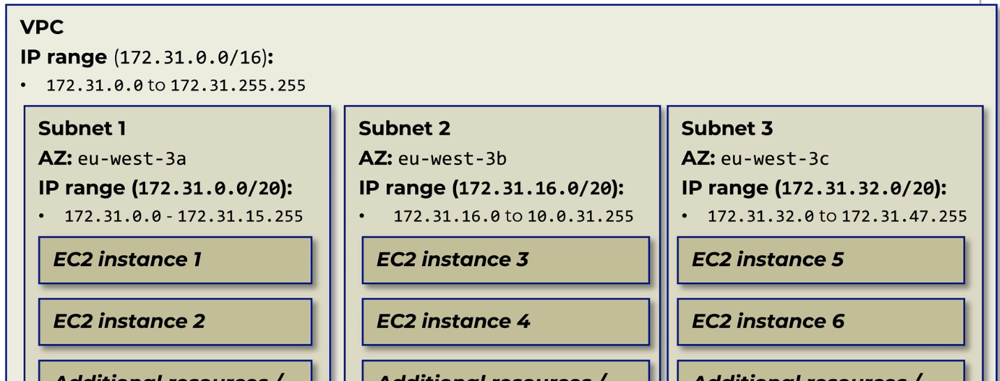
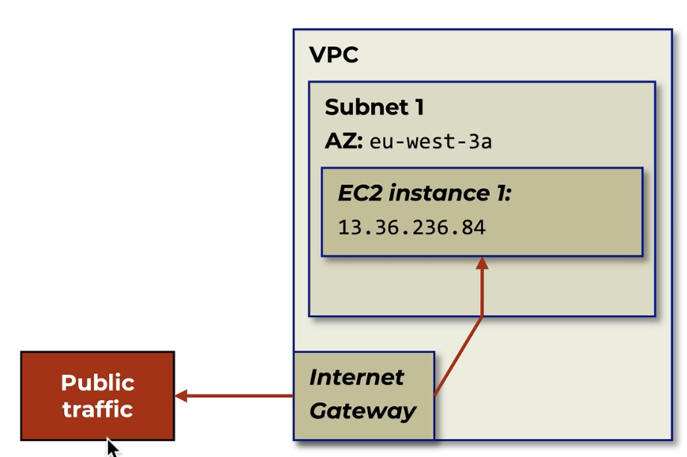
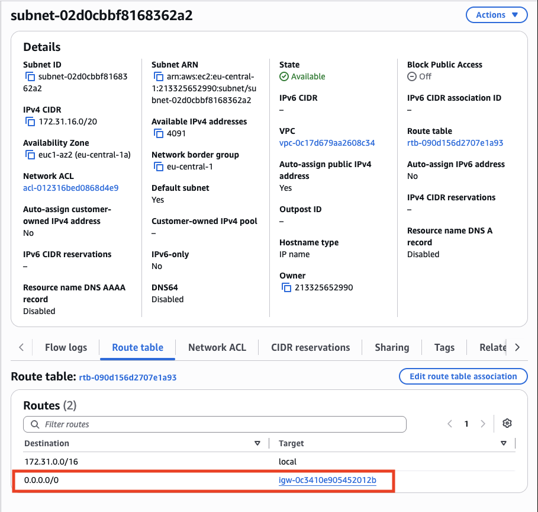
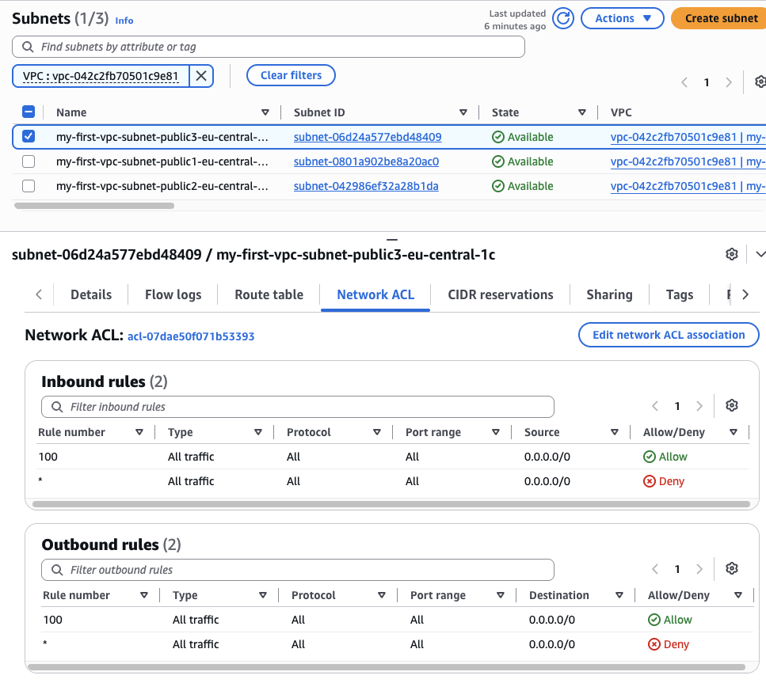

# Networking in AWS

## Virtual Private Cloud(VPC)

### What?

- A VPC is your own private network inside AWS.
- Resources within VPC can communicate directly to each other 
- Virtual because networking is emulated by AWS (no physical wires connecting the resources)
- Think of it as renting a fenced piece of land in the AWS data center to build your cloud environment.
- You control which resources can live there, how they communicate, and who can reach them.

### How?

- Choose an IP address range for the VPC, such as `10.0.0.0/16`.
- Divide the VPC into subnets, like separate neighborhoods for organizing resources.
- Put internet-facing resources in public subnets and internal resources in private subnets.
- Use route tables like road signs to decide where network traffic should go.
- Use an internet gateway as the front gate for communication with the public internet.
- Use security groups and network ACLs as security guards that allow or block traffic.

### Why?

- A VPC isolates your AWS resources from other customers and from unwanted network traffic.
- It lets you design a network that matches your application instead of accepting a one-size-fits-all setup.
- Private subnets help protect databases and internal services by keeping them away from direct internet access.
- Clear network rules make applications safer, easier to troubleshoot, and easier to scale.

> Note:
>
> - By default AWS creates a default VPC for each region.
> - Private IP address is only accessible from within a VPC.
> - Public IP address is to access from the internet.

> Address range naming convention (CIDR notation):
>
> - The number before `/` is the network address, such as `10.0.0.0`.
> - The number after `/` shows how many bits identify the network.
> - In `10.0.0.0/16`, the first 16 bits identify the VPC and the remaining 16 bits identify individual IP addresses.
> - A `/16` range contains 65,536 IP addresses; AWS reserves 5, leaving 65,531 usable addresses.

## Subnets

### What?

- A subnet is a smaller network carved out of a VPC's IP address range.
- Think of a VPC as a city and subnets as separate neighborhoods within that city.
- Each subnet belongs to one Availability Zone, which helps keep resources organized and resilient.

### How?

- Choose a smaller, non-overlapping CIDR range from the VPC range, such as `10.0.1.0/24`.
- Place resources in the subnet, such as web servers in one subnet and databases in another.
- Attach a route table to decide where traffic from the subnet can travel.
- A public subnet has a route to an internet gateway; a private subnet does not have a direct route to it.
- Use multiple subnets in different Availability Zones to spread resources across separate AWS locations.

### Why?

- Subnets organize resources and control how they communicate.
- Public subnets are useful for internet-facing resources, while private subnets help shield internal resources.
- Separating web servers, application services, and databases reduces unnecessary access between layers.
- Using multiple Availability Zones helps an application continue working if one location has a problem.

> Note:
>
> - By default, VPC is configured so that all subnets can communicated to nodes in other subnets. But this can be changed in route tables.

## Steps to configure a VPC in AWS

1. Open the AWS Console, search for **VPC**, and select **Create VPC**.
2. Under **Resources to create**, choose one:
	- **VPC only:** Creates only the VPC. You configure subnets, gateways, and route tables yourself.
	- **VPC and more:** Creates the VPC plus common resources automatically. **This is a good beginner choice for a complete basic network**.
3. Enter a **Name tag**, such as `my-first-vpc`.
4. Enter an **IPv4 CIDR block**, such as `10.0.0.0/16`.
5. For **IPv6 CIDR block**, keep the default **No IPv6 CIDR block** unless IPv6 is required.
6. Choose **Tenancy** to decide whether EC2 instances use shared or dedicated physical hardware. Leave it as **Default** to use AWS's shared hardware, which is the normal and most cost-effective choice; choose **Dedicated** only when compliance or licensing requires it.
7. If you chose **VPC and more**, configure the additional form fields:
	- **Number of Availability Zones:** Choose at least `2` for high availability.
	- **Number of public subnets:** Choose the number needed for internet-facing resources.
	- **Number of private subnets:** Choose the number needed for internal resources.
	- **NAT gateways:** Add one if private resources need outbound internet access.
	- **VPC endpoints:** Add them when private resources must access AWS services without using the public internet.
8. Review the preview and estimated costs, then select **Create VPC**.
9. Confirm that the VPC, subnets, route tables, internet gateway, and any NAT gateways were created successfully.

## Internet Gateways

### What?

- An Internet Gateway (IGW) is the VPC's connection to the public internet.
- Think of it as the main entrance and exit gate between your private AWS city and the outside world.
- It supports communication between resources in a VPC and the internet when the required routing and public IP addresses are configured.

### How?

- Create an Internet Gateway and attach it to the VPC.
- Add a route such as `0.0.0.0/0` to a public subnet's route table, pointing to the Internet Gateway.
- Give an internet-facing resource a public IPv4 address or Elastic IP address.
- Remember: an Internet Gateway alone does not make a subnet public; the route table must point to it.
- Internet Gateways are highly available and managed by AWS, so you do not need to provision or maintain servers for them.

### Why?

- It allows public resources, such as web servers and load balancers, to receive and send internet traffic.
- It provides a controlled path between a VPC and the internet instead of exposing every resource automatically.
- Resources in private subnets remain inaccessible from the internet when their route tables do not point to the Internet Gateway.

> Note:
>
> - An instance needs a public IPv4 address, a route to the Internet Gateway, and appropriate security rules to communicate with the public internet.

## Network Access Control Lists

### What?

- A Network Access Control List (NACL) is a set of traffic rules that protects a subnet.
- Think of it as a security checkpoint at the entrance to a neighborhood: every traveler going in or out is checked.
- A NACL can allow or deny traffic using details such as IP address, port, and protocol.

### How?

- Every VPC has a default NACL, and each subnet is associated with one NACL at a time.
- Add inbound and outbound rules with a rule number; AWS evaluates rules from the lowest number to the highest.
- The first matching rule decides whether traffic is allowed or denied.
- NACLs are stateless: allowing inbound traffic does not automatically allow the response outbound, so both directions need appropriate rules.
- You can create a custom NACL and associate it with one or more subnets.

### Why?

- NACLs provide an extra security boundary around an entire subnet.
- They can block unwanted IP addresses or traffic before it reaches resources in the subnet.
- They are useful as a broad safety layer, while security groups provide more targeted protection for individual resources.

> Note:
>
> - NACLs are **stateless**, while security groups are **stateful**. A security group automatically allows response traffic for an approved connection; a NACL requires separate inbound and outbound rules.
> - By default NACL allows all traffic.

## Security Groups

### What?

- A security group is a virtual firewall that controls traffic to and from AWS resources.
- Think of it as a guest list for a building: only approved visitors can enter, and approved residents can make outgoing requests.
- Security groups are attached to resources such as EC2 instances, not directly to subnets.

### How?

- Add inbound rules to allow required traffic, such as HTTP on port `80`, HTTPS on port `443`, or SSH on port `22`.
- Add outbound rules to control traffic leaving the resource.
- Rules specify the protocol, port, and source or destination, such as an IP range or another security group.
- Security groups are stateful: when an allowed request receives a response, the response is automatically allowed back.
- Security groups allow traffic by default only when a rule permits it; they do not have explicit deny rules.
- A resource can use multiple security groups, and the rules from all of them are combined.

### Why?

- Security groups provide focused, resource-level protection for EC2 instances and other AWS services.
- They help expose only the ports an application needs, reducing unnecessary access.
- Referencing another security group is safer and easier to maintain than listing changing IP addresses.
- They work alongside NACLs: security groups protect resources, while NACLs provide a broader subnet-level boundary.

> Note:
>
> - Security groups are **stateful** and support **allow** rules only. NACLs are **stateless** and support both **allow** and **deny** rules.

> Note:
> - You can use the same security group as the rule's destination to allow all resources associated with that security group to communicate with one another.
>   - **Example:** Attach the same security group to related resources and allow that security group as the destination for internal traffic. The resources can communicate with one another, while separate rules selectively allow approved traffic from the public internet.

## Guide to debug network issues:

- To access another instance/resource in AWS, several conditions must be fulfilled.
- Especially the following:

    - Route to Host:
        - We must be able to connect to another instance:
            - We must be in the same VPC
            - The VPC/route table/.. must be configured properly
            - Network ACL must allow this connection
    - Security group(most common issue)
        - The security group(s) on the outgoing side must allow the connection
        - The security group(s) on the receiving side must allow the connection
    - For internet access:
        - Public IP + Subnets needs to have an Internet Gateway + Internet Gateway is in the Route Table
        - (or we would have to configure a NAT Gateway (not explored further in the course))
    - Permissions(IAM):
        - When accessing an AWS service, we must be allowed to access it(from a permission perspective)
